<div align="center">



<br/>

[](https://github.com/HammasT1/Ben10_watch_flutter/actions/workflows/build-apk.yml)
[](https://github.com/HammasT1/Ben10_watch_flutter/releases/latest)
[](https://github.com/HammasT1/Ben10_watch_flutter/releases)
<br/>


<h3>
  <a href="https://github.com/HammasT1/Ben10_watch_flutter/releases/latest">📥 Download APK</a>
  &nbsp;·&nbsp;
  <a href="#-features">✨ Features</a>
  &nbsp;·&nbsp;
  <a href="#-alien-roster">👽 Aliens</a>
  &nbsp;·&nbsp;
  <a href="#-getting-started">🚀 Get Started</a>
  &nbsp;·&nbsp;
  <a href="#-building--releasing">📦 Releases</a>
</h3>

<sub>Spin the dial · pick an alien · slam the core · go hero, until the watch times out.</sub>

</div>


## ✨ Features

<table>
  <tr>
    <td width="50%" valign="top">
      <h4>🧊 3D Intro</h4>
      A rotatable 3D watch model greets you. Hit <b>ACTIVATE</b> to power it up.
    </td>
    <td width="50%" valign="top">
      <h4>🎛️ Physics Dial</h4>
      Drag or flick the dial. It carries momentum and snaps cleanly onto each alien slot.
    </td>
  </tr>
  <tr>
    <td valign="top">
      <h4>🎨 Per-Alien Theming</h4>
      Each alien has its own glow color, used across the whole UI while it's active.
    </td>
    <td valign="top">
      <h4>📇 Info Cards</h4>
      Swipeable cards with species, homeworld, powers and a stat breakdown.
    </td>
  </tr>
  <tr>
    <td valign="top">
      <h4>⚡ Transform Effects</h4>
      Charge-up, flash, shockwave, sparks, bubbles and ring pulses, all drawn by hand with <code>CustomPainter</code>.
    </td>
    <td valign="top">
      <h4>⏳ Timeout &amp; Recharge</h4>
      You get 15 seconds as an alien, with warning beeps near the end. Then the watch turns red and needs 8 seconds to recharge.
    </td>
  </tr>
  <tr>
    <td colspan="2" valign="top" align="center">
      <h4>🔊 Sound &amp; Haptics</h4>
      A click for each dial step, transform and revert sounds, a buzz when the watch refuses, and a one-tap mute toggle.
    </td>
  </tr>
</table>

### 🔁 How the watch works




## 👽 Alien Roster



<details>
<summary><b>🧬 Add or edit an alien</b></summary>

<br/>

Everything about an alien lives in [`lib/data/aliens.dart`](lib/data/aliens.dart):

```dart
Alien(
  name: 'XLR8',
  species: 'Kineceleran',
  homeworld: 'Kinet',
  description: 'A raptor-like speedster…',
  powers: ['Super speed', 'Enhanced reflexes', 'Wall running', 'Cyclones'],
  color: Color(0xFF3BA8FF),
  stats: AlienStats(strength: 4, speed: 10, intelligence: 5, durability: 4),
  image: 'assets/images/1.png',
),
```

1. Put the artwork in `assets/images/` as `<slot>.png`.
2. Add or edit the `Alien(...)` entry. The dial updates itself from the list.
3. Run `python3 tool/readme_art.py` to regenerate the README artwork from the new list.

</details>


## 📥 Install on Android

1. Open the [**latest release**](https://github.com/HammasT1/Ben10_watch_flutter/releases/latest).
2. Download an APK:

   | File | Use it for |
   |:--|:--|
   | 🟢 `ben10-watch-<ver>-universal.apk` | **Any phone.** Pick this one if you're not sure. |
   | `ben10-watch-<ver>-arm64-v8a.apk` | Most phones from the last few years (smaller download) |
   | `ben10-watch-<ver>-armeabi-v7a.apk` | Older 32-bit phones |
   | `ben10-watch-<ver>-x86_64.apk` | Emulators and Chromebooks |

3. Open the file and allow **Install unknown apps** if Android asks.


## 🚀 Getting Started

**Prerequisites:** [Flutter SDK](https://docs.flutter.dev/get-started/install) 3.47+ (Dart 3.9+). For Android builds you also need Android Studio or the Android SDK, plus JDK 17.

```bash
git clone https://github.com/HammasT1/Ben10_watch_flutter.git
cd Ben10_watch_flutter
flutter pub get
flutter run
```

> [!NOTE]
> The 3D intro needs a WebView-capable platform (Android, iOS or Web). On Linux and Windows desktop the app skips straight to the watch.

```bash
flutter test   # run the test suite
```


## 📦 Building & Releasing

**Local build:**

```bash
flutter build apk --release                  # universal APK
flutter build apk --release --split-per-abi  # one APK per CPU type
```

Output: `build/app/outputs/flutter-apk/`

**Automated releases:** pushing a version tag starts [`build-apk.yml`](.github/workflows/build-apk.yml). It builds every APK and attaches them to a GitHub Release.

```bash
git tag -a v1.0.1 -m "Release v1.0.1"
git push origin v1.0.1
```

> [!TIP]
> The tag sets the version (`v1.0.1` becomes `1.0.1`). You can also run the workflow by hand from the **Actions** tab.


## 🗂️ Project Structure

<details>
<summary><b>Show file tree</b></summary>

<br/>

```text
lib/
├── main.dart                 # App entry, theme, intro → watch routing
├── data/
│   └── aliens.dart           # Alien roster: names, colors, powers, stats
├── models/
│   ├── alien.dart            # Alien & AlienStats models
│   ├── watch_phase.dart      # idle → transforming → transformed → recharging
│   └── effect_seeds.dart     # Randomized seeds for particle effects
├── screens/
│   ├── intro_screen.dart     # 3D model intro with ACTIVATE button
│   └── omnitrix_screen.dart  # Dial, core, timers and transform logic
├── widgets/
│   ├── alien_image.dart      # Silhouette / lit alien rendering
│   ├── alien_info_sheet.dart # Swipeable alien info cards
│   └── transformed_view.dart # Active-alien view with countdown
├── painters/                 # CustomPainter effects
│   ├── bubble_painter.dart
│   ├── ring_pulse_painter.dart
│   ├── shockwave_painter.dart
│   └── spark_painter.dart
└── services/
    └── watch_feedback.dart   # Sound effects, haptics and mute
assets/
├── images/                   # Alien artwork (slot N → N.png)
├── models/                   # .glb 3D watch model
└── sounds/                   # .wav sound effects
tool/
└── readme_art.py             # Generates the animated README artwork
```

</details>

## 🛠️ Tech Stack

| | Package / API | Purpose |
|:-:|:--|:--|
| 🧊 | [`model_viewer_plus`](https://pub.dev/packages/model_viewer_plus) | Interactive 3D `.glb` watch on the intro screen |
| 🔊 | [`audioplayers`](https://pub.dev/packages/audioplayers) | Low-latency sound effects |
| 🖌️ | `CustomPainter` | Hand-drawn sparks, shockwaves, bubbles and ring pulses |
| ⏱️ | `AnimationController` | Transform, timeout and recharge timing |

## 🎨 Palette


## ⚠️ Disclaimer

This is an unofficial, non-commercial **fan project**, made for learning and fun. *Ben 10*, the Omnitrix and all related characters are trademarks of Cartoon Network / Warner Bros. Discovery. This project is not affiliated with or endorsed by them.

<br/>

<div align="center">



<sub>Made with 💚 and Flutter by <a href="https://github.com/HammasT1"><b>Muhammad Hammas Rasheed</b></a> · ⭐ Star the repo if you liked it!</sub>

</div>
